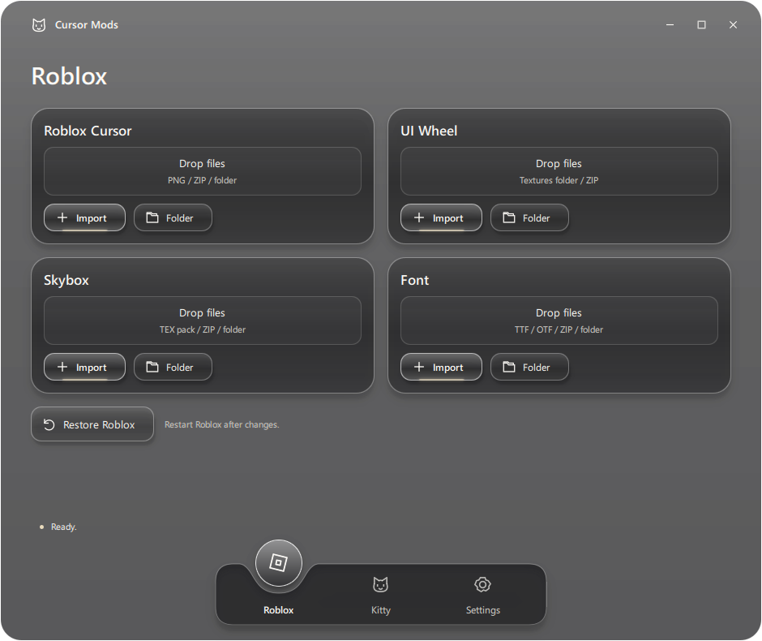

# Cursor Mods

Customize Roblox cursors, UI, skyboxes, and fonts on Windows.

[Downloads](../../releases) · [Discord](https://discord.gg/YVNaKvxcDw)



## Use

Drop a folder or ZIP into **Roblox Cursor**, **UI Wheel**, **Skybox**, or **Font**.
Roblox Cursor also accepts PNGs and matches their filenames to cursor roles.
Font accepts TTF and OTF files. Imports apply immediately; restart Roblox afterward.

Windows cursor controls are at the bottom of Settings. Kitty is an optional
desktop cat. Start with Windows is enabled by default and can be turned off
in Settings. Closing the window keeps the app in the tray; right-click its icon
and choose **Quit** to exit.

## Build

Windows and Python 3.11 are required.

```powershell
py -3.11 -m venv .venv
.venv\Scripts\python.exe -m pip install -r requirements.txt
.venv\Scripts\python.exe main.py
.venv\Scripts\python.exe -m PyInstaller --noconfirm main.spec
```

The executable is written to `dist/cursor-mods.exe`.

## Test

```powershell
.venv\Scripts\python.exe -m unittest discover -s tests -v
.venv\Scripts\python.exe tests/check_glass_ui.py
```

Tests use isolated data and mock Roblox installations.
Settings, packs, backups, and logs normally live in `%USERPROFILE%\.cursormods`.

## License

[MIT](LICENSE). Dependency and sprite credits are in [Third-party notices](THIRD_PARTY_NOTICES.md).

Cursor Mods is not affiliated with Roblox Corporation.
